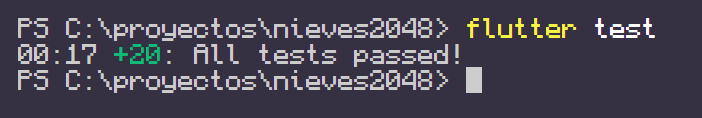
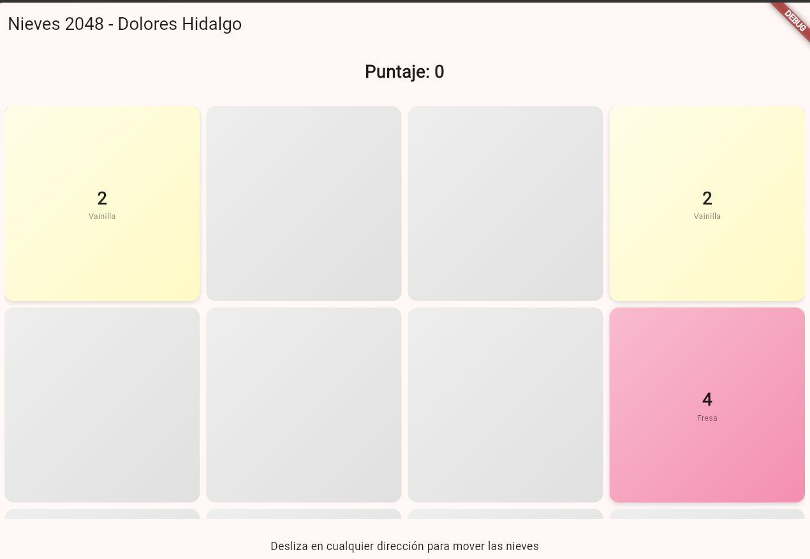
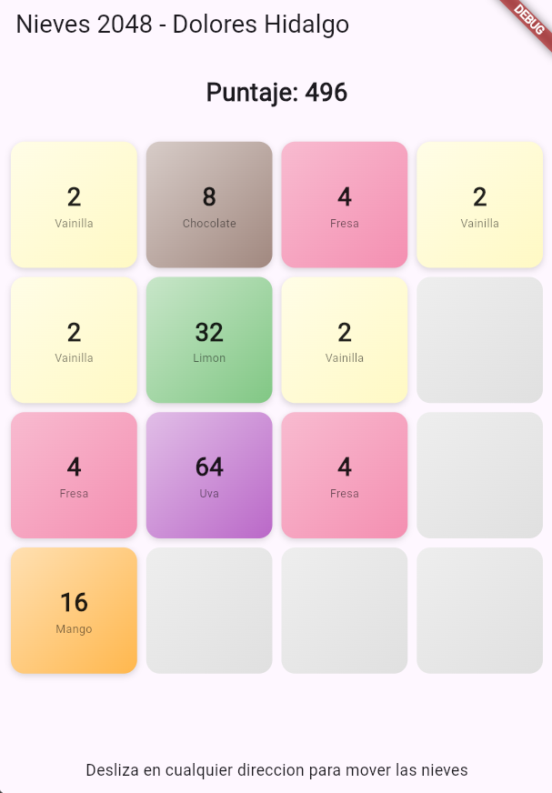

🍦 Nieves 2048 — Evidencia de Proyecto TDD
Desarrollo Móvil Integral | Práctica de Desarrollo Orientado a Pruebas (TDD) en Flutter.

📌 Resumen del Proyecto
Nieves 2048 es un juego de fusión de fichas inspirado en el clásico 2048 pero tematizado con los tradicionales sabores de nieve de Dolores Hidalgo (desde Vainilla hasta la ficha final de 2048: ¡Independencia!). Todo el motor algorítmico (compactación, fusión en 4 direcciones, validación de victorias y derrotas) está aislado en Dart puro y desarrollado bajo TDD.

🎯 Reglas del Juego y Algoritmo Validadas
- Compactación de Filas: Eliminación de huecos manteniendo el orden de las fichas.
- Fusión Exacta: Combinación de pares iguales adyacentes (evitando fusiones múltiples en una sola jugada).
- Movimiento en 4 Direcciones: Reutilización de la lógica horizontal mediante transposición para manejar Izquierda, Derecha, Arriba y Abajo.
- Inserción Aleatoria Determinista: Generación de fichas nuevas (2 o 4) únicamente cuando un movimiento desplaza fichas de su lugar.
- Control de Estado: Detección automática de victoria al alcanzar 2048 y derrota cuando no hay movimientos posibles.

📸 Evidencias de Ejecución

1. 🧪 Pruebas Unitarias e Integración (`flutter test`)
Verificación de las 15/15 pruebas en verde que protegen el motor y las reglas del juego.

📱 2. Interfaz de Usuario y Animaciones (`flutter run`)

| Tablero Principal (Degradados y Sabores) | Pantalla de Victoria / Fin del Juego |
| :---: | :---: |
|  |  |

